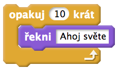

Opakovaně si kladu otázku z článku [6 drsných, ale pravdivých rad, které z tebe udělají lepšího člověka](https://borivojfilip.wordpress.com/2013/07/05/6-drsnych-ale-pravdivych-rad-ktere-z-tebe-udelaji-lepsiho-cloveka/): „Vyjmenujte o sobě pět věcí hodných obdivu.“
Jednou z odpovědí i pevnou součástí mé identity bylo právě vedení kroužku programování.
Letos jsem se rozhodl nepokračovat.
Trochu jsem bilancoval a snažil se identifikovat, co mé rozhodnutí ovlivnilo.
Aktivitám kolem programování pro děti jsem zasvětil, když si trochu zapřeháním, čtvrtinu svého života.
Bonmot praví, že poločas rozpadu dobrovolníka je deset let.
Takhle dlouho jsem doposud nevydržel ani v žádné komerční spolupráci.
Takže bylo celkem jasné, že už jsem se blížil onomu zlomovému okamžiku.

<!--more-->

## Rekapitulace

Začátek mého snažení se datuje do roku 2017, kdy jsme s lidmi z branže lamentovali nad úrovní výuky informatiky.
Nezůstal jsem u nadávání u piva a [začal s kroužkem programování](/software%20development/2018/10/29/jak-jsem-zacal-s-krouzkem-programovani.html).

Od té doby se náplň výuky ve škole naštěstí výrazně posunula.
Šlo to sice pomalu, ale nakonec se to podařilo, a to se počítá.
Školy pořídily zajímavé vybavení, na to se peníze shání poměrně snadno.
Na co se peníze shání o poznání obtížněji, to jsou platy lidí, kteří by děti učili a zakoupenou techniku využili.
Opět v tom spatřuji [Akci Z](https://cs.wikipedia.org/wiki/Akce_Z), kterou tentokrát reprezentuje soukromý nadační fond [Matika Česku](https://www.matikacesku.cz/).
Látá díry ve státním rozpočtu a doplácí začínajícím učitelům 10 000 Kč měsíčně.

Když se ohlédnu, vidím řadu [blogových příspěvků věnovaných didaktice a pomůckám](tag/kroužek-programování/).
Několikrát jsem o tématu přednášel odborné veřejnosti z oblasti softwarového vývoje.
Vedl jsem několik workshopů pro vyučující.
Mám kratičký výstup v Českém rozhlase i [České televizi](https://www.ceskatelevize.cz/porady/1148499747-sama-doma/219562220600015/cast/672302/).
Vyšel mi [článek v časopise Heroine](https://www.heroine.cz/zeny-it/7677-u-budoucich-ajtaku-je-nejdulezitejsi-touha-nespokojit-se-s-prvnim-resenim-rika-lektor-programovani-pro-deti).

Neskromně tedy prohlašuji, že jsem pomáhal káru roztlačit a teď ji táhnou dál jiní.

## Proč končím

Tím, že se výuka ve škole zlepšila (což jsme chtěli), se začal oslabovat můj spasitelský komplex.
Zároveň jsem pociťoval, že vyprchává moje nadšení pro věc.
Je potřeba umět včas odejít, aby člověk nepokračoval jen ze setrvačnosti.

Ke kroužku mě přivedly i sobecné pohnutky, chodily tam moje děti, ale nejstarší syn už odešel na střední.

Působil jsem s kroužkem při škole, což mělo svoje výhody, ale i nevýhody.
Kvalita školství mě neskutečně deptá.
Původně jsem to chtěl uměle naroubovat do jediného blogového příspěvku, něco jak se zpívá: „Branec, ranec, kanec, jak se to rýmuje...“
Školství se budu věnovat extra, pokud vůbec, ale pro ilustraci uvedu jeden konkrétní příklad:
Poslední rok jsem měl deset dětí.
Z toho tři děti odešly na víceletý gympl nebo na domácí vzdělávání.
Aby bylo jasno, nemám nic proti inkluzi, plně ji podporuji.
Zároveň však požaduji, aby se ve škole věnovali dětem, které přesahují šedý průměr, přičemž nemusí být nutně geniální.
Tyhle odstředivé tendence nebyly zcela jistě hlavní důvod, ale mému odhodlání to nepřidalo.

Naopak v rozhodování nehrála roli AI.
Jsem přesvědčený, že znalosti, schopnosti a kompetence, které jsem se snažil předávat, jsou univerzální, tudíž obstojí i v jiných oborech a budoucích časech, ať budou jakékoliv.

## Závěr

Kroužek pokračuje dál i bez mojí účasti, což mi dělá neskutečnou radost.
Já pořád zůstávám duší hračička.
Nevylučuji, že třeba nespáchám nějakou jednorázovou akci.
Ani se nebráním nákupu nových výukových pomůcek.
Dobrovolničení, hravost a práce s dětmi mě budou nadále naplňovat ve skautingu.

## Související

- [Česká televize - Sama doma - Moderní škola](https://www.ceskatelevize.cz/porady/1148499747-sama-doma/219562220600015/cast/672302/)
- [Heroine - U budoucích ajťáků je nejdůležitější touha nespokojit se s prvním řešením](https://www.heroine.cz/zeny-it/7677-u-budoucich-ajtaku-je-nejdulezitejsi-touha-nespokojit-se-s-prvnim-resenim-rika-lektor-programovani-pro-deti)
- [Příspěvky o kroužku programování zde na blogu](tag/kroužek-programování/)
